# Inkinspire Studio: a guide for Sylvia

Everything you need to run Inkinspire yourself. No technical knowledge needed. The Studio lives at **yoursite.com/studio** and works on your phone as well as your laptop.

> **Tip:** press **Ctrl + K** (or **⌘ K** on a Mac) anywhere in the Studio to search for a story, page or person, or to start a new story.

---

## 1. Signing in for the first time

1. Go to **/login** and sign in with the email and the one-time password you were given.
2. You'll be asked to **choose your own password**. A short sentence you'll remember works best (at least 10 characters).
3. Then you'll set up **two-step verification**. Install a free authenticator app on your phone (Google Authenticator, Microsoft Authenticator or 1Password), scan the code on screen, and type the 6 digits it shows.
4. **Save your recovery codes.** If you ever lose your phone, one of these codes lets you in. Download them and keep them somewhere safe, but not in your email.

From then on, signing in asks for your password and a 6-digit code from the app. You can tick "Trust this device for 30 days" on your own laptop and phone.

## 2. The Overview

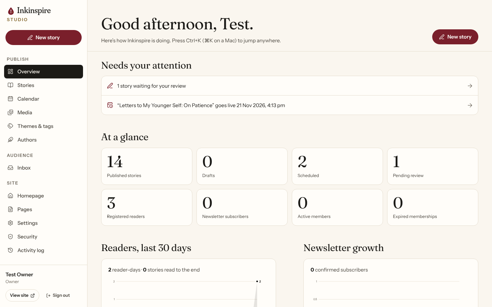

- **Needs your attention** lists anything waiting for you: stories submitted for review, comments to moderate, unread messages, stories about to go live.
- **At a glance** counts your stories, readers, subscribers and members. Tap a card to see the stories behind it.
- **Readers, last 30 days** shows how many people read each day, and how many read a story **to the end**, which is a truer measure than clicks. Hover over (or tap) the chart to see each day; "View as table" shows the numbers.
- **Top stories this month** ranks stories by readers who finished them.

On your phone, the menu is behind the ☰ button, and the pen button starts a new story:

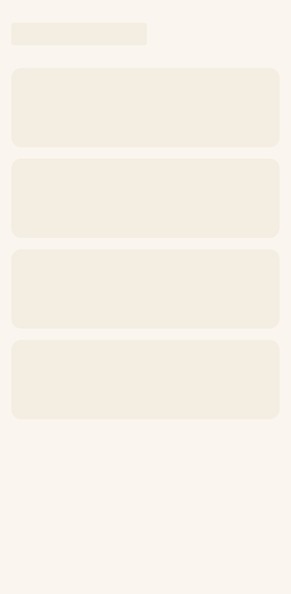

## 3. Writing a story

Press **New story**. The writing room is quiet on purpose: just your words, with settings on the right (or behind the ⚙ button on smaller screens).

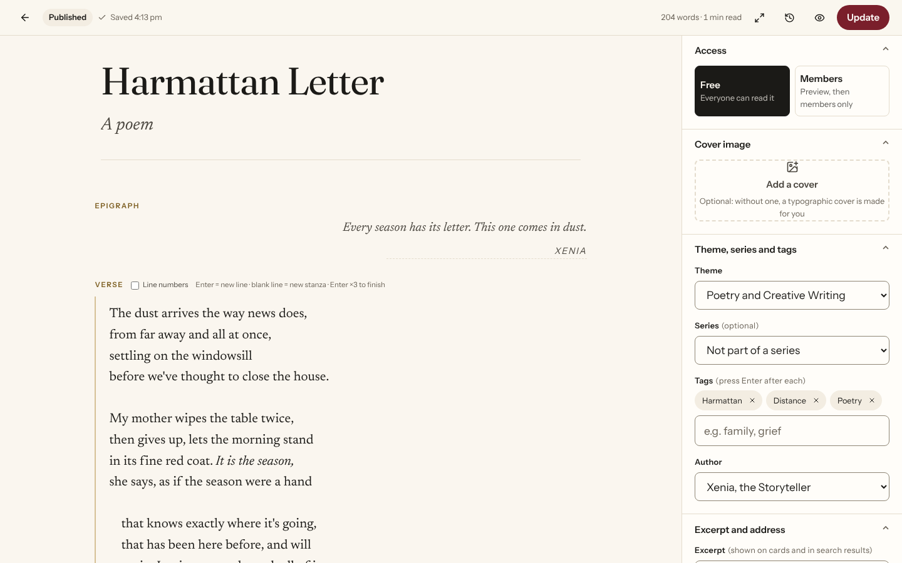

- **Title and subtitle** sit at the top. Press Enter to move into the story.
- **Your work saves itself** every few seconds. The top bar says "Saved" with the time. If your internet drops, it says "Offline: kept on this device" and saves as soon as you're back online. Nothing is lost.
- **Formatting:** select some words to see the small toolbar (bold, italic, link, headings, quotation, drop cap).
- **Type `/` at the start of a line** to insert a literary element:

| Element | What it's for |
|---|---|
| **Verse** | Poems. Every line break, blank line (new stanza) and indent is kept exactly, and long lines wrap gracefully on phones. Press Enter three times at the end to leave the poem. Tick "Line numbers" for long poems. |
| **Epigraph** | An opening quotation, with the attribution underneath. |
| **Pull quote** | A line from your story, set large between fine rules. |
| **Section break** | A gilt ornament between sections. Click it to change the ornament. |
| **Image** | A photo with caption and credit. You must describe the image ("alt text") so blind readers and Google know what it shows. |
| **Drop cap** | A large first letter for your opening paragraph. |
| **Members line** | For members-only stories: readers without a membership see everything above it, then an invitation to join. |

- **Focus mode** (the ⤢ button, or Ctrl + Shift + F) fades everything except the paragraph you're writing.
- **Version history** (the clock button) lists earlier versions. Click one to see what changed (removed text struck through, added text highlighted), and **Restore** to go back. Your current version is saved first, so a restore can itself be undone.
- **Preview** (the eye button) shows the story exactly as readers will see it.
- **Pasting from Word or Google Docs** works; messy formatting is cleaned up automatically.

On your phone it works the same way:

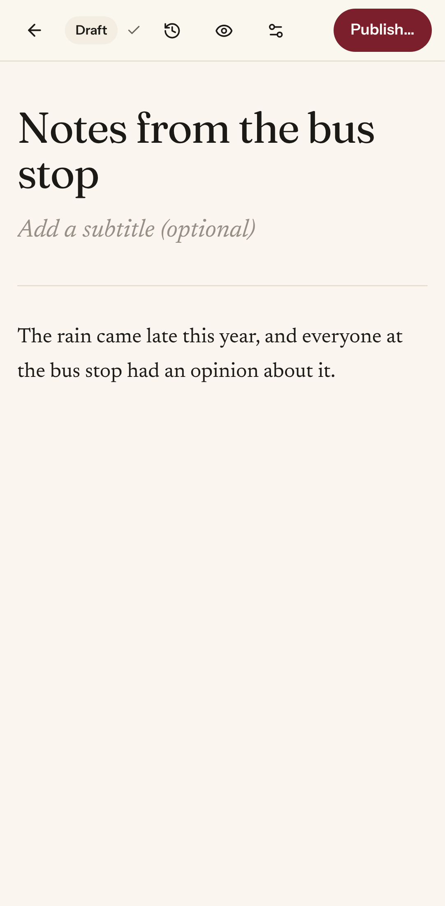

### Story settings (right-hand panel)

- **Access:** *Free* (everyone) or *Members* (preview, then members only).
- **Cover image:** optional. Without one, Inkinspire designs a typographic cover from your title and the theme's colour.
- **Theme, series and tags:** where the story appears on the site.
- **Excerpt:** one or two sentences shown on story cards and in search results.
- **Search and social:** see exactly how the story will look on Google and when shared on WhatsApp.
- **More:** feature the story, allow comments, or **download it as Markdown or JSON**, so your writing is always yours.

## 4. Publishing and scheduling

Press **Publish…** in the top-right corner.

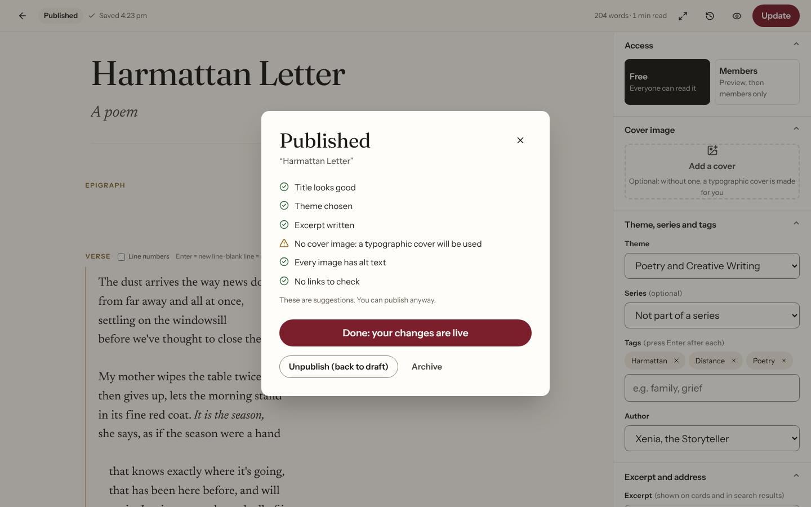

A short checklist points out anything you may have missed (no theme, no excerpt, an image without a description, a members story without a members line, links that don't work). These are suggestions; you can always publish anyway.

- **Publish now** puts it on the site straight away.
- **Schedule** lets you choose a date and time (Lagos time). It appears on the site **at exactly that minute**, even if no one is signed in.
- Once published, the button says **Update**: changes you make go live as they save. You can also **Unpublish** (back to draft) or **Archive** (the address keeps working, with a note that it's from the archive).

If other people write for you, they press **Submit…** instead. You'll see their story under *Needs your attention*. Open it and either publish it or press **Request changes** with a note, which they'll see at the top of their editor.

## 5. Your stories

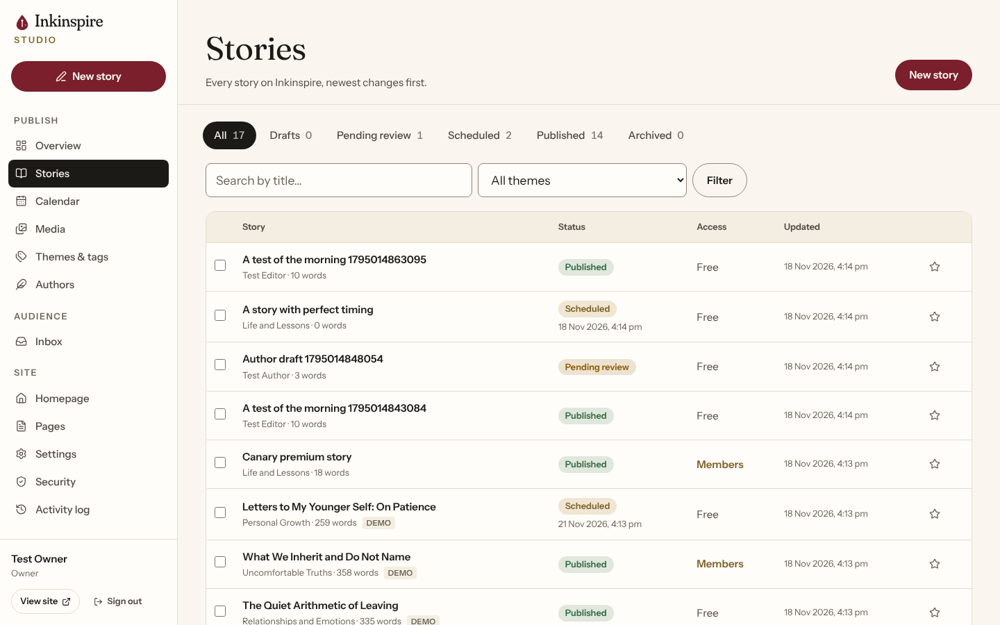

**Stories** lists everything, newest changes first. Use the tabs (Drafts, Pending review, Scheduled, Published, Archived), the search box or the theme filter. Tick several stories to feature, unfeature, make free, make members-only, archive or delete them together. The ★ marks a featured story.

## 6. The calendar

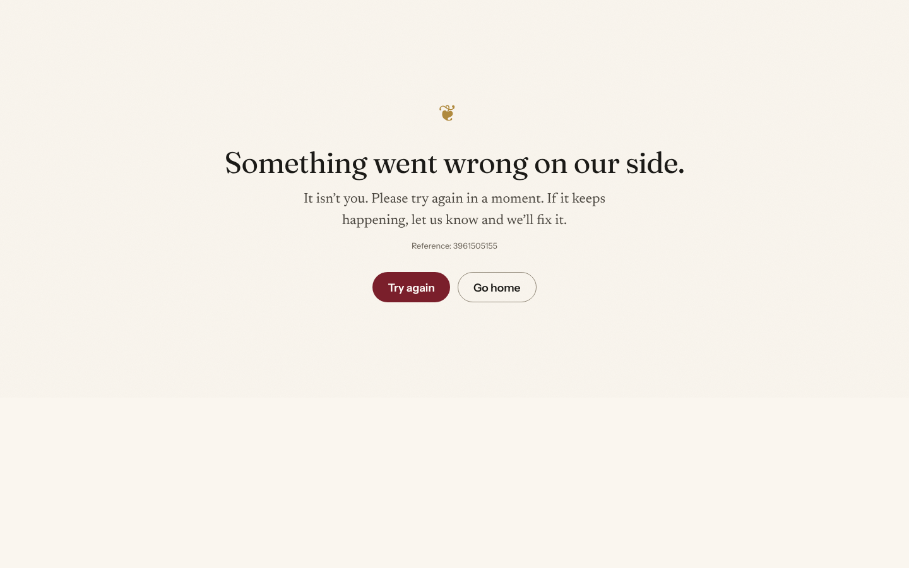

See what's published and what's coming, by month or this week. **Drag a gold (scheduled) story to another day** to move it; it keeps its time.

## 7. Curating the homepage

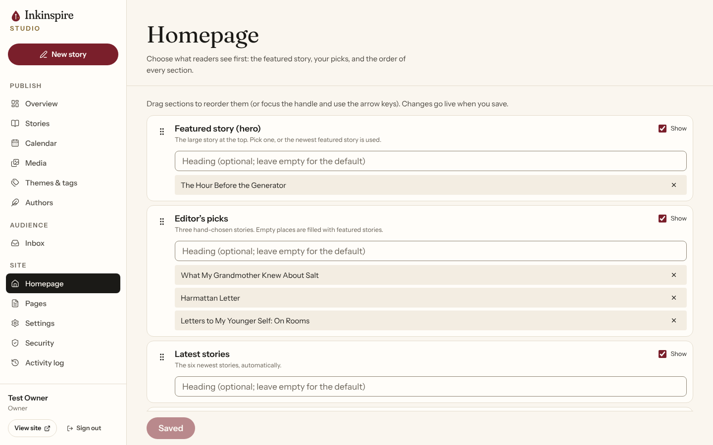

- **Drag sections** (featured story, Editor's picks, latest, most read, themes, your introduction, membership, newsletter) into the order you want, or untick **Show** to hide one.
- Choose the **featured story** and your **three Editor's picks**. Empty places fill themselves with featured stories.
- Give any section your own heading.
- Press **Save homepage**. On a large screen, a live preview sits alongside.

## 8. Themes, series and tags

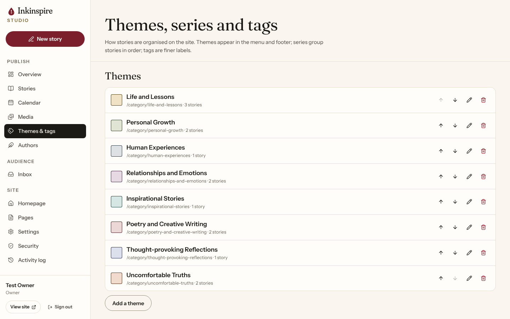

- **Themes** are your eight categories. Add, rename, recolour, reorder, or delete one. When you delete a theme, you choose where its stories go; nothing is lost.
- **Series** group stories in order (like *Letters to My Younger Self*).
- **Tags** are finer labels. Rename one to the name of another to merge them.

## 9. Images, authors and pages

- **Media:** every image you've uploaded. Click one to edit its description, caption and credit, or click the picture to set its **focal point** (the part that stays in view when it's cropped). An image that's in use can't be deleted by accident.
- **Authors:** your profile and any guest writers: photo, biography, tagline and links.
- **Pages:** your About page and the six policy pages.

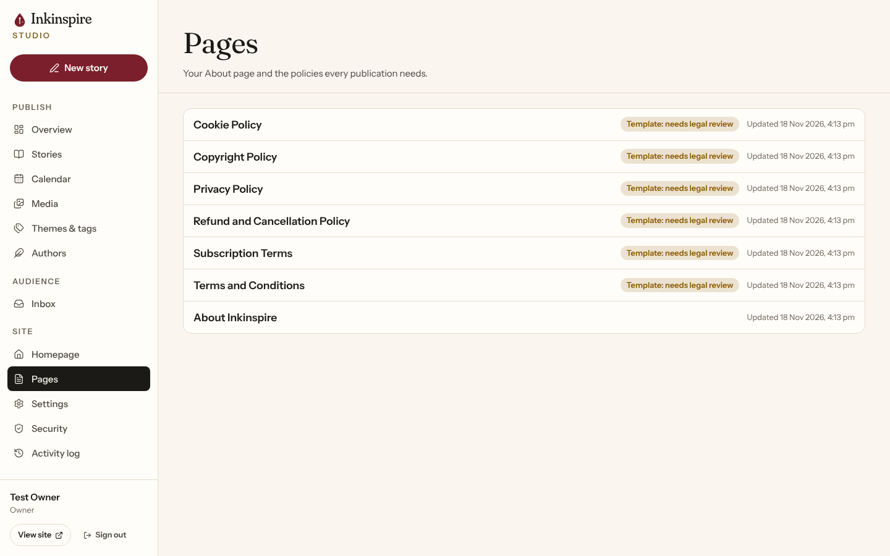

  The policy pages are **templates** and are marked "needs legal review" until you (and your lawyer) have read, edited and saved them.

## 10. Messages

**Inbox** collects messages from your contact page (you also get each one by email). Click to read, **Reply by email**, mark unread, or archive.

## 11. Settings, team and security

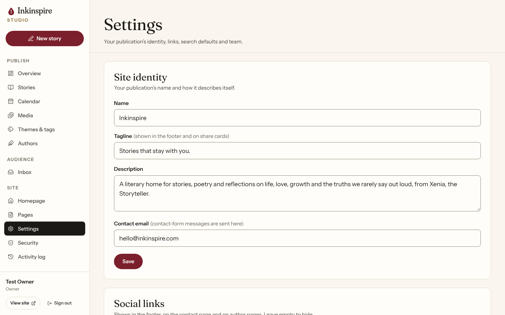

- **Site identity, social links, search defaults, comments and membership rules.**
- **Connected services** shows which outside services are connected (email, image storage, spam protection, analytics, payments) in plain language.
- **Team:** invite an editor, author or moderator. They get an email to set their password, then must turn on two-step verification. Change anyone's role here.
- **Demo content:** when you're ready, remove the sample stories with one button. Your themes, pages and settings stay.
- **Security:** see the devices you're signed in on and sign any of them out, make new recovery codes, change your password, and see recent sign-ins.
- **Activity log:** every important change, who made it and when. Nobody can edit or delete these entries.

## 12. Who can do what

| Role | Can |
|---|---|
| **Owner (you)** | Everything, including payments, connected services and the team |
| **Administrator** | Run the publication, but not change keys, refunds or the team |
| **Editor** | All stories, pages, homepage, newsletter and comments |
| **Author** | Write their own stories and submit them for review |
| **Moderator** | Comments only |

## 13. If something goes wrong

- **Lost your phone?** Sign in with a recovery code, then go to Security and make new codes.
- **Lost your phone and your codes?** Your developer can reset two-step verification after confirming it's you (`RUNBOOK.md` → "Owner locked out").
- **A story looks wrong on the site?** Open it, check the preview, and use Version history to go back if needed.
- **Anything else:** the runbook (`docs/RUNBOOK.md`) is written for whoever helps you.
